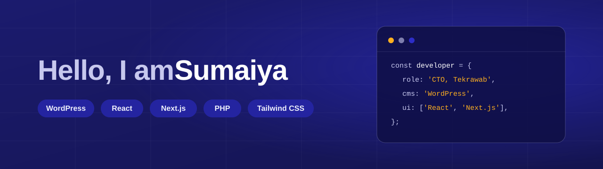

**[🚀 Tekrawab](https://tekrawab.com)**  |  **[🧰 ToolFreeKit](https://toolfreekit.com)**  |  **[💼 LinkedIn](https://www.linkedin.com/in/sumaiya-akter-51b3a2339)**

## 👩‍💻 About

I build **WordPress websites, custom themes and plugins**, and **React / Next.js interfaces**. I am the Co-Founder & CTO of **Tekrawab**, a web agency for service businesses, and I lead the technical development and deployment of **ToolFreeKit**, a free set of browser-based tools.

| Detail | Info |
|---|---|
| 💼 **Role** | Co-Founder & CTO at Tekrawab |
| 📍 **Location** | Chattogram, Bangladesh (remote) |
| 🧩 **WordPress** | Building sites, themes and plugins since 2021 |
| ⚛️ **React & Next.js** | Professional experience since 2024 |
| 🎯 **Focus** | Fast, clean and maintainable code |

## 🚀 Tekrawab: Web Agency

[**Tekrawab**](https://tekrawab.com) designs and builds WordPress websites for service businesses. Every project is scoped with a **fixed price**.

| Service | What you get |
|---|---|
| 🌐 **Website & Landing Page Design** | Responsive, search-friendly websites matched to your brand |
| 📝 **Smart Forms** | Forms with conditional logic and file uploads to capture leads |
| 📅 **Appointment Calendars** | Online booking with 24/7 availability and email reminders |
| 👥 **CRM & Marketing Automation** | Manage contacts, email lists and follow-up sequences in WordPress |
| 🔐 **Specialized Client Portal** | A client portal built on your own WordPress domain |

➕ **And more services:** see [all Tekrawab services](https://tekrawab.com/services/).

🎁 **Free homepage concept:** request yours at [tekrawab.com](https://tekrawab.com/request-your-free-concept/).

## 🧰 ToolFreeKit: Digital Tool Website

[**ToolFreeKit**](https://toolfreekit.com) is a product built by the Tekrawab team: **11 free tools** that run in your browser.

| Category | Details |
|---|---|
| 📄 **PDF** | Tools for working with PDF files |
| 🖼️ **Images** | Tools for working with images |
| ✍️ **Text** | Tools for working with text |
| 🔳 **QR codes** | Tools for QR codes |
| 🔒 **Privacy** | Nothing is uploaded to the ToolFreeKit server. |

## 🛠️ Tech Stack

**⚛️ Frontend**

&nbsp;&nbsp;<a href="https://nextjs.org" title="Next.js"><picture><source media="(prefers-color-scheme: dark)" srcset="assets/icons/nextjs-dark.svg"></picture></a>&nbsp;&nbsp;&nbsp;&nbsp;&nbsp;&nbsp;&nbsp;&nbsp;

**🧩 WordPress & Backend**

<a href="https://wordpress.org" title="WordPress"><picture><source media="(prefers-color-scheme: dark)" srcset="assets/icons/wordpress-dark.svg"></picture></a>&nbsp;&nbsp;

Also: Gutenberg, GenerateBlocks, Elementor, custom themes and plugins.

**🔧 Tools**

&nbsp;&nbsp;<a href="https://github.com" title="GitHub"><picture><source media="(prefers-color-scheme: dark)" srcset="assets/icons/github-dark.svg"></picture></a>

## 📬 Contact Me

| Where | Link |
|---|---|
| 📧 **Email** | [sumaiya.akter.contact@gmail.com](mailto:sumaiya.akter.contact@gmail.com) |
| 💼 **LinkedIn** | [linkedin.com/in/sumaiya-akter-51b3a2339](https://www.linkedin.com/in/sumaiya-akter-51b3a2339) |
